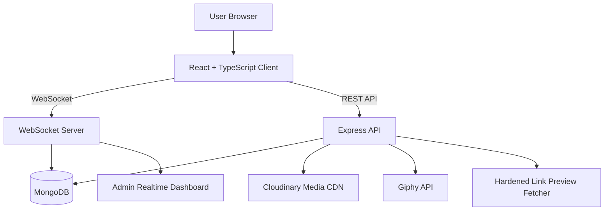

# Pulse Chat

> **A production-grade, real-time, scalable web messaging application engineered for high-fidelity conversations, dynamic multi-room routing, rich media exchange, secure moderation, and a premium responsive user experience.**

[](https://pulsechat.tech)
[](#overview)
[](LICENSE)
[](#technology-stack)
[](#technology-stack)
[](#user-experience-and-visual-design)
[](#realtime-architecture)
[](#technology-stack)

---

## Table of Contents

- [Overview](#overview)
- [Live Application](#live-application)
- [Core Capabilities](#core-capabilities)
- [Multi-Room Architecture](#multi-room-architecture)
- [Messaging Experience](#messaging-experience)
- [Reactions and Engagement](#reactions-and-engagement)
- [Media and File Pipeline](#media-and-file-pipeline)
- [Link Intelligence](#link-intelligence)
- [Security and Privacy](#security-and-privacy)
- [Moderation and Administration](#moderation-and-administration)
- [User Experience and Visual Design](#user-experience-and-visual-design)
- [Realtime Architecture](#realtime-architecture)
- [System Architecture](#system-architecture)
- [Technology Stack](#technology-stack)
- [Environment Configuration](#environment-configuration)
- [Local Development](#local-development)
- [Production Build](#production-build)
- [Project Structure](#project-structure)
- [Operational Notes](#operational-notes)
- [Community & Governance](#community--governance)
- [License](#license)

---

## Overview

**Pulse Chat** is a real-time scalable web messaging platform built for fast, reliable, and expressive digital communication. It combines persistent WebSocket messaging, secure REST services, MongoDB-backed persistence, Cloudinary-powered media delivery, hardened link preview handling, and a refined React interface optimized for desktop and mobile interaction.

The application is designed around five engineering priorities:

1. **Realtime reliability** — persistent WebSocket communication, heartbeat health checks, reconnection awareness, and ordered history delivery.
2. **Multi-room isolation** — dynamic routing, private aliases, distinct moderation boundaries, and secure joining mechanisms.
3. **Security-first interaction** — strict validation, ReDoS/NoSQL injection prevention, rate limiting, URL sanitation, and robust device fingerprinting.
4. **High-performance UI** — virtualized rendering, adaptive overscan, optimized media previews, lock-solid scrolling mechanics, and premium micro-interactions.
5. **Operational control** — admin telemetry, live audit streams, blocking workflows, invite controls, report intake, and message event history.

---

## Live Application

- **Production URL:** [https://pulsechat.tech](https://pulsechat.tech)
- **About the Developer:** [https://pulsechat.tech/about-developer](https://pulsechat.tech/about-developer)
- **Repository:** [https://github.com/2harshpandey/pulse-chat](https://github.com/2harshpandey/pulse-chat)

---

## Core Capabilities

Pulse Chat includes a complete real-time messaging foundation suitable for high-concurrency conversational workflows.

- Persistent multi-user WebSocket messaging with heartbeat `ping` / `pong` reliability checks.
- Instant join and leave system notifications broadcast to active participants.
- Unique username enforcement across both HTTP authentication and WebSocket connection layers.
- Session-aware reconnect handling to prevent false leave events during page refreshes.
- Persistent client identity using cryptographically strong locally stored user identifiers.
- Server-side user tracking with join history, last-seen metadata, and moderation context.
- Initial chat history delivery on connection with paginated infinite scrolling for deeper history.
- Chronological message ordering with oldest-first delivery and safe prepend behavior during history loads.
- **Sliding Window Virtualization**: Powered by `react-virtuoso` with high-performance windowing, rendering tens of thousands of messages without UI freezes or memory bloat.
- Adaptive overscan and viewport tuning for desktop and mobile scrolling performance.
- **Instant Quote & Pin Navigation**: High-speed jump navigation that bulk loads message pages to eliminate timeouts when navigating to deeply historical messages.
- **High-Speed History Engine**: Fluid high-velocity scrolling with continuous near-top loading, layout metric anchoring, and guaranteed auto-scroll bottom suppression while reading older messages.

---

## Multi-Room Architecture

Pulse Chat supports distinct, securely isolated rooms, allowing vast communities to thrive in parallel.

- **Dynamic Room Creation**: Users can spin up custom rooms instantly with custom names, descriptions, and privacy settings.
- **Aliases & Namespaces**: Support for human-readable aliases (e.g., `/my-cool-room`). Features the protected `/me` namespace for global default chat and personal isolation with an adaptive light & dark mode ID copy widget.
- **Public Room Discovery**: A rich dashboard allowing users to search, browse, and filter active public rooms with live telemetry (e.g., active user counts).
- **Private Rooms**: Securely locked behind dynamic "Join Passwords". Adding a password to a public room implicitly transitions it to a private room.
- **Room-specific Moderation**: Admin credentials and dashboards are sandboxed per room, allowing distributed community moderation.

---

## Messaging Experience

The messaging layer is built to support modern conversation patterns while preserving performance and consistency.

- Reply and quote system with preview bar, sender context, and clickable quoted message blocks.
- **Pinned Announcements & Jump Navigation**: Dynamic header banner displaying active room pins with animated highlight sweeps, seamless cyclic navigation across both current and historical server messages, and real-time synchronization on pins, unpins, and deletions.
- Quoted media thumbnails optimized through Cloudinary transformations for low-latency previews.
- **Inline Message Editing**: Full edit support with `(edited)` state tracking, event logging, and live synchronization to clients.
- Delete-for-everyone workflow with content redaction and persistent event logging.
- Local delete and uploaded-media removal flows where applicable.
- Contextual message action toolbar optimized for hover and touch interaction.
- Selection mode with checkbox interface for multi-message workflows.
- Bulk actions including delete, copy, edit, and report where relevant.
- **Intelligent Realtime Presence Engine**:
  - **Granular Activity Types**: Distinguishes between standard text typing (`typing`), live voice recording (`recording_audio`), active media file transit (`sending_photo`, `sending_video`, `sending_audio`, `sending_file`, `sending_media`, `sending_gif`), and GIF picker discovery (`gif_selecting`).
  - **Live Voice Recording Indicator**: Active voice note recording renders `[username] is recording an audio...` with live animated soundwave bars, transitioning to `[username] is sending an audio...` with bouncing dots only while the audio payload is actually transferring over the network.
  - **Upload Presence Protection**: While media files are actively uploading in chunks, sending presence is strictly protected from race conditions or generic input resets, maintaining visibility until the transfer succeeds or fails (with a 1,000ms minimum visibility delay for smooth transitions).
  - **Flicker-Free Caption Typing**: Writing a caption inside the media preview modal displays the user's standard typing indicator (`is typing...`) without false sending alerts; opening or auto-focusing the modal never emits premature typing events.
  - **Instant Clear on Empty**: Deleting all typed characters in a caption or message input immediately clears typing presence across all room participants without waiting for debounce timeouts.
  - **Multi-User Presence Aggregation**: Supports concurrent distinct presence activities across different participants, cleanly rendering singular, dual, and 3+ user groups separated by activity dividers (e.g., `Alex is recording an audio... · Sam is sending a photo... · Taylor is typing...`).

---

## Reactions and Engagement

Pulse Chat provides lightweight engagement tools designed for clarity and real-time consistency.

- **Emoji Reactions**: A beautifully animated, sliding bottom-sheet emoji picker optimized for touch, ensuring reactions can be added quickly without disrupting flow.
- One reaction per user enforcement with toggle and replace behavior.
- Reaction detail popup with per-emoji tabs, reaction counts, and aggregate “All” view.
- Self-reaction removal directly from the popup participant list.
- Persistent reactions stored securely in the database with safe map serialization for client delivery.

---

## Media and File Pipeline

The media layer supports rich file exchange while applying strict safety and performance controls.

### Supported media workflows

- Images (JPG, PNG, WebP, GIF, SVG)
- Videos (MP4, WebM, MOV)
- Voice Messages & Audio Files (MP3, WAV, OGG, M4A, AAC, OPUS, FLAC, WEBA, WMA)
- GIFs (integrated Giphy search & custom URLs)
- Generic documents and file attachments
- Multi-file upload batches
- Captioned upload sends

### Upload and preview features

- Cloudinary-backed uploads through secure multipart handling.
- File metadata preservation for accurate rendering and downloads.
- **Tiered Upload Limits**: 
  - Raw/General Files: Max **10 MB**.
  - High-res Media (Photos/Videos): Max **100 MB**.
  - Clear, distinct UI error messaging seamlessly integrated into the chat feed for limit violations.
- Drag-and-drop uploads with full-screen overlay and animated affordance.
- WhatsApp-style file preview modal with:
  - Multi-file carousel preview.
  - Attachment add and remove controls.
  - Caption input per send batch.
  - Thumbnail strip navigation.
- Inline media rendering with consistent frame sizing and intelligent constraints to prevent scroll jitter or horizontal stretching.
- Image lightbox with zoom controls, wheel scaling, and polished overlay behavior.

### Consecutive media grouping & albums

- **WhatsApp / Telegram Style Mosaic Albums**: Consecutive media messages (photos and videos) sent within close proximity by the same user automatically merge into clean responsive albums (1-tile, 2-tile, 3-tile, 4-tile layouts).
- **Overflow Counter Badge**: Albums with more than 4 items render an interactive `+N` badge indicating remaining media.
- **On-Demand Media Load Gating**: Grouped and individual media tiles feature on-demand "Tap to load" gating with size badges and lightweight blurred placeholder frames (~1 KB), preventing heavy background preloading and eliminating memory pressure during fast scrolling.
- **Full-Screen Media Gallery Modal**: Tapping any photo/video opens a mobile-optimized gallery lightbox with touch swipe navigation, thumbnail carousel strip, download buttons, and automatic full-resolution loading.
- **Single-Click Album ZIP Downloads with Live Cancellation**: Download an entire mosaic album or selection as a compressed `.zip` archive on demand, featuring live percentage progress, duplicate filename prevention, and real-time abort cancellation via status toasts and context menus.

### Custom video player

Pulse Chat includes a purpose-built video playback interface with:

- Play and pause controls.
- Timeline scrubber.
- Duration display.
- Playback speed cycling.
- Fullscreen layout reflow.
- Picture-in-Picture support.
- Loop toggle.
- Mute and volume controls.
- Double-tap seek shortcuts.
- Auto-hiding controls.
- **Seamless Playback Position Preservation**: Captures video timestamp during background stream-to-blob transitions, eliminating mid-play rewind glitches.
- Automatic off-screen pause when scrolled out of view unless Picture-in-Picture is active.

### Voice messaging & audio player

Pulse Chat includes a built-in voice recorder and audio playback engine designed for seamless audio messaging:

- **One-Tap Voice Recording**: Interactive microphone control in the chat footer with live recording timer, real-time animated waveform feedback, and instant cancel or send workflows.
- **Universal Audio Rendering**: Native voice recordings and uploaded audio tracks across all major formats (`.mp3`, `.wav`, `.ogg`, `.m4a`, `.aac`, `.opus`, `.flac`, `.weba`, `.wma`, etc.) automatically render as rich, interactive audio bubbles.
- **Interactive Deterministic Waveforms**: Dynamic 36-bar acoustic waveform visualization with hover and drag scrubbing, precise click-to-seek navigation, and played/unplayed color differentiation across light and dark modes.
- **Playback Speed Toggle**: Quick-cycle speed controls (`1x` → `1.5x` → `2x`) for fast voice note consumption.
- **Global Audio Playback Coordinator**: Auto-pauses previous audio streams whenever another audio or video player starts playing to prevent overlapping audio.
- **Duration & Progress Display**: Crisp mm:ss elapsed and total duration readouts.
- **Direct Download Affordance**: One-click download button to save audio files locally.
- **Keyboard & Accessibility Support**: Spacebar toggle, arrow key seeking, and ARIA attributes for screen readers.

### Download and caching controls

- Hover-only media download overlay for images and videos.
- Download progress ring with cancel capability.
- Secure downloads through allowlisted hosts and hardened proxy fallback.
- IndexedDB media cache keyed by user, message, and source for faster reloads.
- URL sanitation to block unsafe protocols and reduce XSS risk.

---

## Link Intelligence

Pulse Chat automatically enriches shared links while protecting the backend from unsafe network access.

- **Multi-Level Subdomain & TLD Recognition**: Auto-detects and formats bare links (e.g., `web.whatsapp.com`, `maps.google.co.in`) without requiring `http://` or `www.`, supporting traditional and modern gTLDs (`.xyz`, `.top`, `.club`, `.chat`, etc.).
- **Multi-Tier Favicon & Touch-Icon Resolution**: Extracts official high-res apple-touch-icons (~2.8 KB) from scraped pages, falling back to root-domain Google Favicons and DuckDuckGo icons without 404 image placeholder hijacking.
- **Contained Preview Framing**: Renders icons and preview art cleanly with `object-fit: contain;` inside dedicated flexbox wrappers to prevent clipping.
- **Preview Caching**: In-memory and stateful caching to eliminate redundant metadata network requests.
- **Server-Side SSRF Hardening**:
  - DNS resolution checks.
  - Private and internal IP blocking (loopback, 10.0.0.0/8, 172.16.0.0/12, 192.168.0.0/16, AWS metadata 169.254, IPv6 ULA/link-local).
  - Port restrictions (HTTP 80 / HTTPS 443 only).
  - Redirect hop limits.
  - Size-capped HTML reads.

---

## Security and Privacy

Security is treated as a primary system requirement rather than an afterthought.

### Application safeguards

- **CodeQL CWE-20 Incomplete URL Substring Sanitization Mitigation**: Completely eliminates loose string `.includes()` checks on URLs and hostnames. Hostnames are parsed via standard `URL` objects and validated against strict domain and subdomain boundaries (`.endsWith()`).
- **Query Injection Prevention**: Complete immunization against NoSQL injections by strictly casting query parameters (e.g., `roomId`) and leveraging `$eq` MongoDB operators.
- **ReDoS Prevention**: Escaped and sanitized regex workflows using strict `escapeRegExp` helpers, preventing Denial of Service attacks on search endpoints.
- Multi-layer rate limiting for authentication, uploads, API endpoints, and admin routes.
- Strict validation for usernames, tokens, passwords, and report reasons.
- Device fingerprinting using screen, platform, language, timezone, and user-agent context.
- User, IP, and device block enforcement across HTTP and WebSocket pathways.
- Login lockdown mode with timed or indefinite enforcement.
- Safe URL sanitation against `javascript:` and unsafe `data:` payloads.

### Download proxy hardening

- Host allowlisting.
- Redirect safety checks.
- Private IP resolution blocking.
- Sanitized filenames.
- Fallback proxy behavior for trusted media download flows.

---

## Moderation and Administration

Pulse Chat includes a dedicated administrative control plane for live moderation and operational visibility.

- Password-protected admin dashboard.
- Live admin WebSocket channel for instant telemetry updates.
- Online user list with session and status tracking.
- Force logout for individual users or all active users.
- User blocking and unblocking with fingerprint merging.
- **Room Settings Management**: Change aliases, descriptions, and convert rooms between Public/Private dynamically via the dashboard.
- Temporary invite link management:
  - Time-boxed invite creation.
  - Link revocation.
  - Usage tracking.
  - Copy-to-clipboard interface.
- Login lockdown controls with preset and custom durations.
- Message history log covering edits, deletions, uploads, and creation events.
- Categorized audit event stream with timestamps.
- User report intake with message snapshot, session data, join history, and metadata.
- Server log tailing with real-time WebSocket streaming and one-click clipboard copy buttons with visual confirmation across both Real-Time Activity and Server Logs.
- Permanent history purge and frontend-only hide controls for compliance workflows.

---

## User Experience and Visual Design

The interface is designed to feel premium, responsive, and stable under heavy interaction.

- **Lock-Solid Scrolling**: Highly optimized scrolling mechanics, eliminating "nested scrollbar" bugs and utilizing `overflow-x: clip`. Native `scrollRestoration` is handled manually to prevent layout shifting on load.
- **Full Progressive Web App (PWA)**: Completely installable on desktop and mobile platforms with offline caching, custom install prompts, standalone window experience, and service worker updates via Vite PWA.
- **Light & Dark Theme Parity**: Carefully crafted tokens and responsive styled components delivering perfect contrast, accessibility, and visual hierarchy across light and dark modes (including modals, forms, and room ID widgets).
- Contextual notification sound system providing audio cues for new messages and user joins. To prevent audio fatigue, it intelligently gates sounds to play only when the chat tab is backgrounded or the device is locked. Users can control this behavior via an animated toggle that persists their preferences locally.
- Animated UI layers including glow, shimmer, floating orbs, and smooth transitions, alongside premium informational callout boxes.
- Adaptive mobile layouts with touch-optimized controls.
- Keyboard-aware login experience for mobile viewport changes.
- Custom scrollbars and stable long-list behavior, ensuring `min-height: 100vh` fills the exact viewport properly on all devices.
- Themed error pages for `403`, `404`, `408`, `429`, `500`, and `503` states.
- Error boundary protection to prevent full-page application failure.

---

## Realtime Architecture

Pulse Chat uses a hybrid communication model:

| Channel | Purpose |
| --- | --- |
| WebSocket | Live messages, typing state, GIF selection presence, reactions, moderation telemetry, and system events. |
| REST API | Authentication, uploads, link previews, GIF discovery, admin workflows, reports, and operational actions. |
| MongoDB | Persistent storage for users, messages, events, reports, moderation state, and chat state. |
| Cloudinary | Media upload storage, delivery, and transformation-backed previews. |
| Giphy API | GIF search and discovery. |

- **Low-Latency Handshake & Dispatch**: Early browser preconnect/DNS-prefetching, socket `TCP_NODELAY` frame dispatch, single-pass compound indexed block verification, and concurrent initial history and pin resolution.
- **Resilient Reconnection**: Exponential backoff with sub-second initial retry (`600ms`), tab visibility recovery, and automatic heartbeat ping/pong keepalive.

---

## System Architecture



### Client application

- React 18 and TypeScript interface.
- Styled Components design system.
- React Router routing.
- WebSocket-driven chat experience.
- REST integration for authentication, uploads, previews, GIFs, reports, and admin actions.
- Virtualized message list for large histories.

### Server application

- Express HTTP API.
- WebSocket server using `ws`.
- MongoDB persistence through Mongoose.
- Cloudinary media storage.
- Multer multipart upload handling.
- Winston logging.
- Hardened metadata preview and download proxy services.

---

## Technology Stack

| Layer | Technologies |
| --- | --- |
| Frontend | React 18, TypeScript, Vite, Styled Components, React Router v7, React Virtuoso, Emoji Picker React, `@use-gesture/react`, Vite PWA |
| Backend | Node.js, Express, WebSocket `ws`, MongoDB, Mongoose, Multer, Axios, Winston |
| Media | Cloudinary |
| GIF Search | Giphy API |
| Storage | MongoDB, IndexedDB media cache |
| Tooling | Vite, TypeScript, Vitest, npm |

---

## Environment Configuration

Create environment files for the server and frontend before running locally.

### Backend environment variables

| Variable | Required | Description |
| --- | --- | --- |
| `MONGODB_URI` | Yes | MongoDB connection string. |
| `ADMIN_PASSWORD` | Yes | Password used to access the admin dashboard. |
| `CLIENT_PASSWORD` | Yes | Password required for standard chat login. |
| `ADMIN_SECRET` | Yes | Secret used to authorize protected admin requests. |
| `CLOUDINARY_CLOUD_NAME` | Yes | Cloudinary cloud name. |
| `CLOUDINARY_API_KEY` | Yes | Cloudinary API key. |
| `CLOUDINARY_API_SECRET` | Yes | Cloudinary API secret. |
| `GIPHY_API_KEY` | Yes | Giphy API key for GIF discovery. |

### Frontend environment variables

| Variable | Required | Description |
| --- | --- | --- |
| `REACT_APP_API_URL` | Yes | Base URL for the backend API. |
| `REACT_APP_ADMIN_SECRET` | Yes | Admin secret used by protected frontend admin workflows. |

---

## Local Development

Install and run the backend and frontend separately.

### Backend

```bash
cd backend
npm install
npm run dev
```

### Frontend

```bash
cd frontend
npm install
npm run dev     # or: npm start
```

After both services are running, open the frontend development URL shown by Vite.

---

## Production Build

Build the frontend production bundle:

```bash
cd frontend
npm run build
```

The optimized output is generated in the frontend build directory.

---

## Project Structure

```text
.
├── backend/
│   ├── index.js
│   ├── db.js
│   ├── logger.js
│   ├── middleware.js
│   ├── security.js
│   ├── state.js
│   ├── models/
│   ├── routes/
│   │   ├── admin/
│   │   ├── auth.js
│   │   ├── download.js
│   │   ├── gifs.js
│   │   ├── linkPreview.js
│   │   ├── media.js
│   │   ├── messages.js
│   │   └── rooms.js
│   └── websocket/
│       ├── messageHandler.js
│       ├── presenceHandler.js
│       ├── broadcast.js
│       ├── pinnedManager.js
│       └── adminHandler.js
├── frontend/
│   ├── public/
│   ├── src/
│   │   ├── admin/               # Modular tabs, modals, subhooks, styles
│   │   ├── auth/                # Modular auth forms, card, controller, styles
│   │   ├── chat/                # Modular chat hooks, components, styles, types
│   │   ├── errors/              # Modular error pages & icons
│   │   ├── home/                # Modular landing components & controller
│   │   ├── rooms/               # Modular room explorer & controller
│   │   ├── App.tsx
│   │   ├── Chat.tsx
│   │   ├── Admin.tsx
│   │   ├── Rooms.tsx
│   │   ├── Auth.tsx
│   │   ├── Home.tsx
│   │   ├── AboutDeveloper.tsx
│   │   └── ThemeContext.tsx
│   ├── index.html
│   └── vite.config.mts
├── README.md
└── netlify.toml
```

---

## Operational Notes

- WebSocket connections use heartbeat behavior to detect stale sessions.
- Chat history is loaded initially and then extended through pagination with sliding window virtualization to preserve memory.
- Large message lists are virtualized via `react-virtuoso` with ResizeObserver tracking to eliminate layout shift (CLS).
- Off-screen video auto-pause conserves system resources and network bandwidth.
- Hardened security verified by GitHub CodeQL: SSRF protections, URL sanitization, and query injection prevention.
- Media download and preview logic intentionally restricts unsafe URLs and hosts.
- Admin workflows are protected and designed for live operational control.
- The About Developer page includes semantic HTML, dynamic metadata, Open Graph tags, and JSON-LD `Person` structured data for search indexing.

---

## Community & Governance

- **[Contributing Guide](CONTRIBUTING.md)** — Guidelines for local development setup, code conventions, and submitting pull requests.
- **[Contributors](CONTRIBUTORS.md)** — Recognition of project creators and community contributors.
- **[Code of Conduct](CODE_OF_CONDUCT.md)** — Contributor Covenant standards for an inclusive, welcoming community.
- **[Security Policy](SECURITY.md)** — Vulnerability reporting channels, response process, and security safeguards.

---

## License

This project is licensed under the **[MIT License](LICENSE)**.

Copyright (c) 2026 Harsh Pandey. See the [LICENSE](LICENSE) file for complete details.
