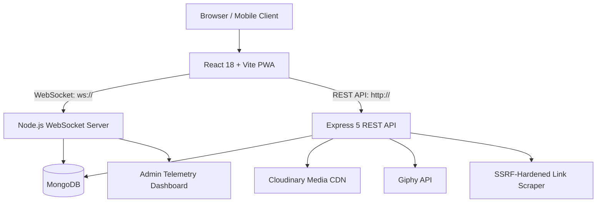

# Pulse Chat

> **A modern, production-grade real-time messaging application engineered for fast conversations, dynamic multi-room routing, rich media exchange, side panel media galleries, voice messaging, and responsive light/dark themes.**

[](https://pulsechat.tech)
[](#overview)
[](LICENSE)
[](#technology-stack)
[](#technology-stack)
[](#system-architecture)
[](#technology-stack)
[](#core-capabilities)

---

## Table of Contents

- [Overview](#overview)
- [Live Application](#live-application)
- [Core Capabilities](#core-capabilities)
- [System Architecture](#system-architecture)
- [Technology Stack](#technology-stack)
- [Quick Start](#quick-start)
- [Environment Configuration](#environment-configuration)
- [Project Structure](#project-structure)
- [Community & Governance](#community--governance)
- [License](#license)

---

## Overview

**Pulse Chat** is a scalable, real-time messaging platform built for high-performance communication. It combines persistent native WebSocket connections, Express 5 REST APIs, MongoDB persistence, Cloudinary media delivery, hardened link previews, and a domain-modular React 18 interface with full light and dark mode parity.

### Engineering Priorities

1. **Real-Time Reliability**: Sub-second reconnection, heartbeat keepalives, ordered message delivery, and session-aware recovery.
2. **Multi-Room Isolation**: Namespace routing, custom aliases, dynamic password locks, and sandboxed room moderation.
3. **Defense-in-Depth Security**: Session token authorization, rate limiting, SSRF hardening, NoSQL query immunization, and ReDoS prevention.
4. **Fluid Performance**: Virtualized sliding-window rendering (`react-virtuoso`), on-demand media gating, and zero layout shift.
5. **Rich Media Intelligence**: Mosaic albums, fullscreen lightbox with zoom engines, in-browser photo cropping, and side gallery explorers.

---

## Live Application

- **Production App:** [https://pulsechat.tech](https://pulsechat.tech)
- **About the Developer:** [https://pulsechat.tech/about-developer](https://pulsechat.tech/about-developer)
- **GitHub Repository:** [https://github.com/2harshpandey/pulse-chat](https://github.com/2harshpandey/pulse-chat)

---

## Core Capabilities

### 1. Real-Time Messaging & Presence
- **Native WebSockets**: Low-latency bidirectional messaging with heartbeat `ping`/`pong` checks and automatic reconnection.
- **Virtualized Message Feed**: Powered by `react-virtuoso` with sliding-window memory management, rendering tens of thousands of messages without frame drops.
- **Granular Presence Engine**: Distinguishes standard typing (`typing`), live voice recording (`recording_audio`), media transfer (`sending_photo`, `sending_video`, `sending_file`), and GIF browsing (`gif_selecting`).
- **Quotes & Pin Navigation**: Header announcement banner for pinned messages with animated highlight sweeps, and instant jump navigation for deeply nested quotes.
- **Inline Editing & Redaction**: Full edit support with `(edited)` badges, plus delete-for-everyone and session-scoped local delete flows.

### 2. Side Panel Media Viewer
- **Segmented View Switcher**: High-contrast, theme-aware toggle in the sidebar between active online users and room media.
- **Mutually Exclusive Filters**: Category tabs for **Photos**, **Videos**, **Docs**, and **Links** with smooth horizontal mouse-wheel scrolling on desktop.
- **Infinite Cursor Pagination**: Efficient reverse-chronological cursor paging with real-time sync for deletions, room clears, and new messages.
- **Direct Proxy Downloads**: Document attachments trigger secure backend proxy downloads (`preferProxy: true`), preventing cross-origin token leakage.

### 3. Mosaic Albums & Fullscreen Gallery
- **Dynamic Mosaic Albums**: Consecutive photos and videos from the same user merge automatically into responsive 1-to-4+ tile albums with `+N` overflow counters.
- **Interactive Lightbox Modal**: Touch pinch-to-zoom, rapid double-tap zoom/restore, mouse double-click, and dedicated desktop zoom controls (`+`, `-`, `1:1`).
- **In-Browser Photo Cropper**: Client-side image editor with 8 drag handles, rule-of-thirds grid, 90-degree rotations, and `Ctrl+Z`/`Ctrl+Y` undo/redo history.
- **Granular Reactions**: Floating reaction badges on individual photos within albums, aggregated summary pills, and reaction breakdown sheets.
- **Single-Click ZIP Downloads**: Export entire albums or selections into compressed `.zip` archives with live progress and cancel affordances.

### 4. Voice Messaging & Audio Engine
- **One-Tap Voice Recording**: Interactive microphone recorder with live timer, animated soundwaves, and instant cancel/send workflows.
- **36-Bar Acoustic Waveforms**: Interactive SVG waveform visualization with drag scrubbing, seek navigation, and played/unplayed color differentiation.
- **Playback Controls**: Quick-cycle speed controls (`1x` → `1.5x` → `2x`) and a global coordinator preventing overlapping audio/video streams.

### 5. Multi-Room Routing & Discovery
- **Public & Private Rooms**: Instant custom room creation with optional join passwords. Adding a password dynamically transitions a public room to private.
- **Discovery Dashboard**: Search, filter, and browse public rooms with live participant counts and metadata telemetry.
- **Protected `/me` Namespace**: Dedicated default chat space and personal isolation mode with an adaptive ID copy widget.

### 6. Link Intelligence & Security
- **Smart Link Previews**: Auto-detects bare links without protocol prefixes, generating rich Open Graph preview cards with high-res favicon scrapers.
- **Server-Side SSRF Protection**: Validates URLs, resolves DNS before connection, restricts ports (80/443), and blocks private/loopback IP ranges.
- **Security Hardening**: Session token validation on sockets, NoSQL injection prevention with `$eq` casting, ReDoS sanitization, and frame rate caps.

### 7. Moderation & Administrative Suite
- **Protected Dashboard**: Telemetry console with real-time WebSocket event streams and one-click log clipboard exports.
- **Operational Controls**: User blocking with device fingerprinting, session force-logouts, login lockdown modes, and temporary access link generation.

---

## System Architecture



---

## Technology Stack

| Layer | Technologies |
| --- | --- |
| **Frontend** | React 18, TypeScript, Vite, Styled Components, React Router v7, React Virtuoso, `@use-gesture/react`, Vite PWA |
| **Backend** | Node.js (>=20), Express 5, Native WebSockets (`ws`), Mongoose, Multer, Winston, Axios |
| **Database** | MongoDB (Atlas or Local Community Server), IndexedDB media cache |
| **Media & CDN** | Cloudinary (multipart chunked uploads, transformation pipelines), JSZip |
| **GIF Search** | Giphy API |
| **Tooling & Tests**| Vitest, Testing Library, PostCSS, npm |

---

## Quick Start

### Prerequisites
- **Node.js** (v20.x or later) & **npm** (v9.x or later)
- **MongoDB** instance (local or free [MongoDB Atlas](https://www.mongodb.com/cloud/atlas) cluster)
- Free **Cloudinary** account (for media storage)
- Free **Giphy API Key** (optional, for GIF picker)

### 1. Clone the Repository
```bash
git clone https://github.com/2harshpandey/pulse-chat.git
cd pulse-chat
```

### 2. Backend Setup
```bash
cd backend
npm install
Copy-Item .env.example .env    # On Linux/macOS: cp .env.example .env
npm run dev
```
*The backend server will listen at `http://localhost:8080` (WebSocket on `ws://localhost:8080`).*

### 3. Frontend Setup
In a separate terminal:
```bash
cd frontend
npm install
npm run dev
```
*The client application will start at `http://localhost:3000`.*

> [!TIP]
> For platform-specific setup details (such as Windows PowerShell policies or dependency peer-resolutions), see the detailed guides in [backend/README.md](backend/README.md) and [frontend/README.md](frontend/README.md).

---

## Environment Configuration

### Backend (`backend/.env`)
| Variable | Required | Description |
| --- | --- | --- |
| `MONGODB_URI` | **Yes** | MongoDB connection string (Atlas URI or local `mongodb://localhost:27017/pulsechat`) |
| `ADMIN_PASSWORD` | **Yes** | Master password for admin dashboard authentication |
| `CLIENT_PASSWORD` | **Yes** | Password required for standard chat room login |
| `ADMIN_SECRET` | **Yes** | Secret header token used to authorize protected admin REST routes |
| `CLOUDINARY_CLOUD_NAME` | **Yes** | Cloudinary cloud name for media hosting |
| `CLOUDINARY_API_KEY` | **Yes** | Cloudinary API key |
| `CLOUDINARY_API_SECRET` | **Yes** | Cloudinary API secret |
| `GIPHY_API_KEY` | Optional | GIPHY API key for animated GIF search |

### Frontend (`frontend/.env`)
| Variable | Required | Description |
| --- | --- | --- |
| `REACT_APP_API_URL` | Optional | Backend API base URL (defaults to `http://localhost:8080`) |
| `REACT_APP_ADMIN_SECRET` | Optional | Secret token for frontend admin route authorization |

---

## Project Structure

```text
.
├── backend/
│   ├── index.js                  # Express & HTTP server bootstrap
│   ├── websocket.js              # Native WebSocket connection coordinator
│   ├── db.js                     # MongoDB connection handling
│   ├── logger.js                 # Winston IST logging
│   ├── middleware.js             # Rate limiters, security guards, CORS
│   ├── security.js               # SSRF checks, URL validators, filename sanitizers
│   ├── state.js                  # Active rooms & in-memory connection registry
│   ├── models/                   # Mongoose schemas (messages, rooms, users, audits)
│   ├── routes/                   # Modular REST endpoints (media, links, rooms, auth)
│   └── websocket/                # Socket handlers (messages, presence, pins, admin)
├── frontend/
│   ├── src/
│   │   ├── admin/                # Admin tabs, logs viewer, security controls
│   │   ├── auth/                 # Authentication forms & login controllers
│   │   ├── chat/                 # Message feed, media viewer, composer, audio recorder
│   │   │   ├── components/       # SideMediaGallery, MessagesList, ChatFooter, Lightbox
│   │   │   ├── hooks/            # useChatWebSocket, useChatMediaGallery, useChatAudio
│   │   │   └── styles/           # Theme-aware Styled Components & layout tokens
│   │   ├── rooms/                # Room explorer, join/create modals, room controllers
│   │   ├── errors/               # Themed HTTP error views (403, 404, 500)
│   │   ├── home/                 # Landing page & feature showcase
│   │   ├── App.tsx               # Root application router
│   │   └── index.css             # Light & Dark mode design system tokens
│   ├── public/                   # PWA manifests, icons, service worker assets
│   └── vite.config.mts           # Vite 8 bundling & PWA configuration
├── CONTRIBUTING.md               # Contribution guidelines & Git workflows
├── SECURITY.md                   # Security policy & vulnerability reporting
├── CODE_OF_CONDUCT.md           # Contributor Covenant standard
├── CONTRIBUTORS.md               # Project contributors recognition
└── LICENSE                       # MIT License
```

---

## Community & Governance

- **[Contributing Guide](CONTRIBUTING.md)**: Development setup, commit standards, and pull request guidelines.
- **[Security Policy](SECURITY.md)**: Vulnerability disclosure channels, response timelines, and safeguards.
- **[Code of Conduct](CODE_OF_CONDUCT.md)**: Contributor Covenant community pledge and enforcement rules.
- **[Contributors](CONTRIBUTORS.md)**: Project creators and community recognition.

---

## License

This project is open-source and licensed under the **[MIT License](LICENSE)**.

Copyright &copy; 2026 Harsh Pandey. See [LICENSE](LICENSE) for full details.
